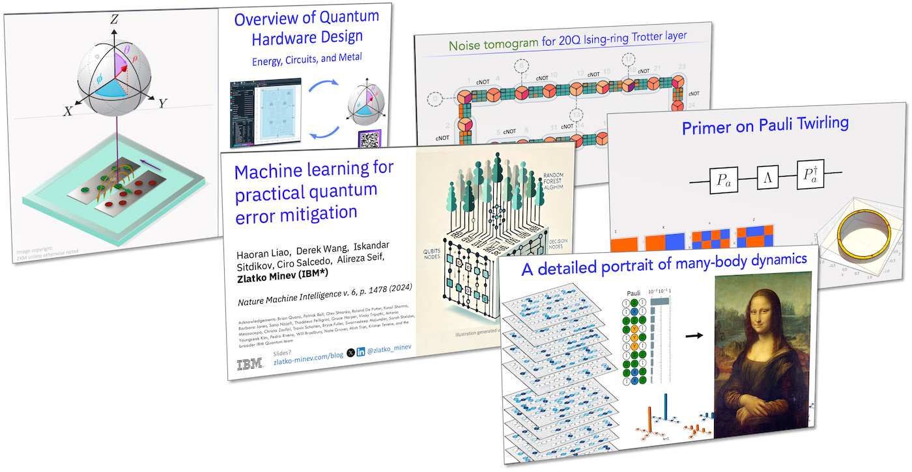

# Zlatko's Quantum Notebook

*Zlatko Minev's talks, lectures and notes, 2011 to the present.*

**Website: [zlatko-minev.github.io/zlatko-minev-quantum-repository](https://zlatko-minev.github.io/zlatko-minev-quantum-repository/)**
: search, filter and open every deck, with a summary, a citation page and
BibTeX for each one.


> "Creating knowledge is only half the story — sharing it is the other half." 




A curated archive of public research talks, educational lectures, tutorials, and technical notes by Zlatko K. Minev, spanning 2011 to the present. This repository aims to serve researchers, students, and enthusiasts in quantum computing, quantum physics, hardware design, and related fields.

For more, visit [zlatko-minev.com](https://zlatko-minev.com).


---

## 📂 Repository Contents

* **Research Talks**: Keynotes, conference talks, seminars, and invited colloquia on quantum error mitigation, superconducting hardware, many-body physics, and topological computing.
* **Educational Lectures**: Lecture slides and materials from summer schools, workshops, and university courses. Includes beginner-to-advanced educational content and career talks.
* **Technical Notes**: Concise derivations, foundational calculations, and working research notes prepared for internal and external dissemination.

---

## 🔍 How to Use This Repository

### Browse the Archive

The easiest way in is the [website](https://zlatko-minev.github.io/zlatko-minev-quantum-repository/),
published from this repository with GitHub Pages on every push to `main`:
search, filter by shelf, topic, year and level, browse lecture series as
stacks, and open any deck in the browser. "New here? Three ways in" on the
home page lists three short reading paths. Run it locally with
`python3 tools/build_site.py --serve`.

Every deck has its own page (`items/<id>/`) and every lecture series one too
(`series/<slug>/`), with Google Scholar metadata and BibTeX. New decks are
announced in the site's Atom feed (`feed.xml`).

Content is organized into three folders — **research talks**, **educational**, and
**tech notes** — and indexed in [`catalog.json`](catalog.json), a machine-readable
database of every item with titles, years, venues, categories, and tags.

### Download Materials

* 📄 Download individual PDFs directly from the folders above
* 🧾 Download a ZIP of the full repository (GitHub → *Code* → *Download ZIP*)
* 🌀 Clone the repository using Git:

  ```bash
  git clone https://github.com/zlatko-minev/zlatko-minev-quantum-repository.git
  ```

---

## 🛠️ Maintaining the Archive

PDFs are compressed to a balanced, web-friendly quality (no Git LFS). To add new
talks and republish, follow the checklist in [`agent/NOTES.md`](agent/NOTES.md). In short:

```bash
python3 tools/add_deck.py NEW.pdf --shelf research --title "…" --year 2027 --venue "…"
                                  # adds one deck end to end; or, step by step:
python3 tools/process_pdfs.py     # compress new/updated PDFs (~150 dpi)
python3 tools/build_catalog.py    # regenerate catalog.json (+ tags)
python3 tools/make_thumbnails.py  # page-1 thumbnails for the website
python3 tools/check_sizes.py      # size guard (also runs in CI)
```

Commit the result and open a pull request; CI checks sizes, the catalog,
thumbnails and frozen citation keys, and merging to `main` redeploys the site.

Display titles, series, venues and dates are curated in
`tools/catalog_overrides.json`, so file names never have to change to fix how an
item appears on the site.

> Pristine, full-resolution originals are archived locally outside the repo.
> `tools/publish.sh` (squash everything into one force-pushed commit) re-uploads
> the whole ~300 MB library, so it's only worth it after replacing or deleting
> large files.

---

## 🤝 Contributing

Spotted a typo, a wrong date or a missing credit? Please open an issue.

---

## 📝 License

Unless a deck says otherwise, the slides and notes are © Zlatko K. Minev and
shared under [CC BY-NC-ND 4.0](LICENSE.md): you're welcome to read, download and
share them, unchanged and non-commercially, with credit and a link back.
Commercial use or a reworked slide or figure in your own talk, course or paper
needs permission; please ask, the answer is usually yes. If you use something
in teaching or a publication, a short note telling me where is appreciated.
Some slides include figures, photos, logos or excerpts from other people and
institutions, credited where they appear; those stay with their
owners and aren't covered by the CC license.

To cite a talk, lecture or note, use the BibTeX on its page on the website, or
`citations.bib` there for everything at once.

